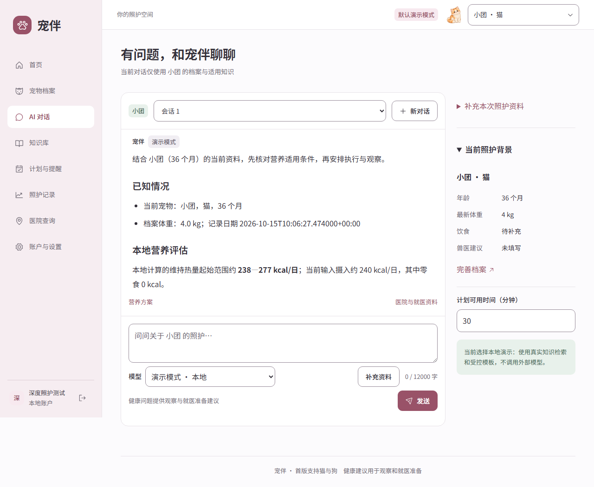

# 宠伴 · Pet Agent

面向猫狗家庭的本地宠物照护助手，把 AI 问答、宠物档案、日常计划和照护记录放在一起。

[快速开始](#快速开始) · [模型配置](docs/STREAMING_CHAT.md) · [开发文档](docs/DEVELOPMENT.md)



*本地演示界面，使用示例档案。支持桌面和手机。*

## 功能

- **AI 问答**：结合宠物资料检索知识，逐段展示回答和来源，支持停止与手动重试。
- **宠物档案**：管理多只宠物的年龄、体重、饮食、过敏和兽医建议。
- **日常照护**：创建计划、站内提醒与打卡，记录体重和日常观察，查看照护复盘。
- **知识与营养**：浏览猫狗照护资料，预览营养方案，对比食品和用品。
- **医院查询**：按地区或附近位置查询，整合高德、天地图资料及导航入口。
- **模型选择**：支持阿里千问、DeepSeek 和兼容接口；内置无需密钥的演示模式。

## 快速开始

准备 Python 3.13、Node.js 24 和 Git。Windows PowerShell：

```powershell
git clone https://github.com/20triplexx-arch/Pet-Agent.git
cd Pet-Agent
powershell -ExecutionPolicy Bypass -File scripts/setup.ps1
powershell -ExecutionPolicy Bypass -File scripts/start.ps1
```

打开 <http://127.0.0.1:8000>。默认使用演示模式，打开页面即可注册账户。更多安装选项见[开发文档](docs/DEVELOPMENT.md)。

Linux / macOS 提供 `sh scripts/setup.sh`、`sh scripts/start.sh`，当前主要在 Windows 验证。

## 可选接入

在服务端环境或本机 `.env` 配置凭证，参考 [.env.example](.env.example)：

- **阿里千问 / DeepSeek**：[模型接入](docs/ALIBABA_CHAT.md) · [免费额度优先与逐段回答](docs/STREAMING_CHAT.md)。
- **高德 / 天地图**：[医院查询配置](docs/HOSPITAL_AGENT.md)。
- **本地 OCR**：安装可选依赖后识别产品标签，识别结果需人工核对。

免费模型池仅使用已核实额度和质量资格的候选；无可用候选时停止调用。

## 开发与文档

React + TypeScript + FastAPI + Pydantic AI + SQLite。

| 文档 | 内容 |
| --- | --- |
| [安装与开发](docs/DEVELOPMENT.md) | 启动、测试、知识导入和数据备份 |
| [产品说明](PRODUCT.md) | 功能与使用流程 |
| [知识来源](docs/SOURCE_CATALOG.md) | 资料出处与覆盖范围 |
| [测试结果](TEST_RESULTS.md) | 验证记录、性能和已知问题 |

当前主要支持猫和狗。健康建议用于日常观察和就医准备，不能代替兽医诊疗；提醒仅在站内显示。质量与速度仍在持续改进。

## 许可证

[MIT](LICENSE)。部分基础代码源自 FastAPI 官方全栈模板，见 [UPSTREAM.md](UPSTREAM.md)。
