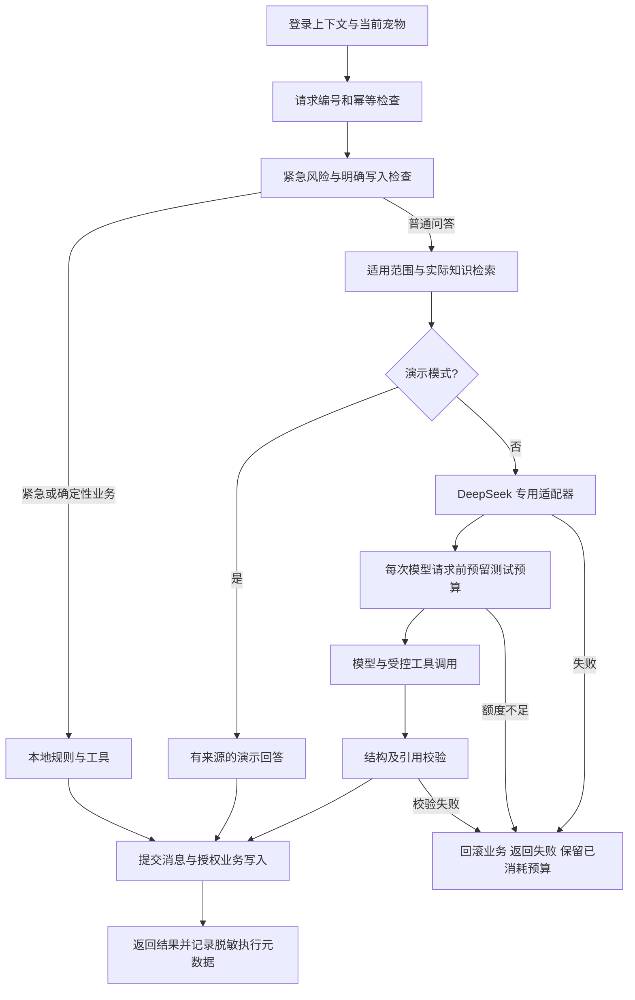

# 宠伴第一阶段：真实模型与质量基线

本阶段把演示产品推进到可重复验证的真实 Agent。范围是 DeepSeek 接入、固定场景评测、执行追踪、自动化回归和数据恢复。2026-10-13后续批次已加入7/30天本地事实复盘、多项记录及出处文字核对，见 [照护复盘](CARE_REVIEW.md)；长期趋势的专业判断、在线多人协作与更多多模态资料仍属后续范围。

## 配置与接口

分发配置仍默认 `DEMO_MODE=true`。本机可选以下服务端配置；密钥从已有环境变量读取，不写进源码或前端：

```dotenv
DEMO_MODE=false
MODEL_PROVIDER=deepseek
DEEPSEEK_MODEL=deepseek-flash
MODEL_MAX_REQUESTS=4
MODEL_MAX_INPUT_TOKENS=32000
MODEL_MAX_OUTPUT_TOKENS=4096
MODEL_CONTEXT_CHARS=48000
MODEL_TIMEOUT_SECONDS=90
MODEL_TURNS_PER_DAY=20
```

DeepSeek 模式只读取 `DEEPSEEK_API_KEY`，固定使用 `https://api.deepseek.com`，请求明确设置 `thinking.type=disabled`。`compatible` 模式继续使用原有 `MODEL_API_KEY`、`MODEL_BASE_URL` 与 `MODEL_NAME`，不借用其他服务商的密钥。服务商、模型与调用参数见 [DeepSeek 官方接入说明](https://api-docs.deepseek.com/quick/_start/pricing/) 和 [思考模式说明](https://api-docs.deepseek.com/guides/thinking_mode/)。

2026-10-12合并深度问答后，以上为新默认预算。已有本机配置未自动覆盖，MODEL_MAX_REQUESTS=6仍可读取但运行限制4次；日常问答采用所配置输出上限，固定评测CLI/预算账本仍保持1800输出及累计10元上限。最近24条消息、来源摘要、多主题BM25、营养事实与补充资料采用[深度问答流程](DEEP_CHAT.md)。合并前真实基线报告保留原实现哈希与费用，不能作为新流程的真实质量结论。

`/health`、`/api/v1/status` 增加 `configuration_error` 状态：选择真实模式却缺少对应密钥时不冒充演示。规则处理的紧急提示、营养计算、草稿与明确保存仍能本地执行；需要模型的问答返回 503。真实模式配置成功只说明配置存在，真实可用性以实际调用结果为准。前端相应显示“真实模型模式”或“模型配置待补充”。

API 响应增加 `X-Request-ID`。成功聊天的 `execution` 包含请求编号、实际模型请求数、用量、耗时、工具执行状态，以及实际检索条目的 ID、来源版本和更新时间。幂等重放返回原响应中的执行记录，新 HTTP 请求编号在响应头中，日志标记 `replayed=true`，不重新调用模型。

工具成功表示函数成功返回；写入最终是否成功以事务提交和 HTTP 结果为准。业务回滚不会撤销服务商已经消耗的模型用量。
失败前已取得的用量会在业务回滚后单独保存，包含来源校验失败；缺少服务商用量的失败保留日志及评测预算预留，不把未知用量编造成零费用。

## 执行过程



日常执行日志在 `backend/storage/execution.jsonl`，单文件最多约 1 MB，保留三个轮转文件。日志不包含原始问题、完整回答、工具参数值、密钥、服务商错误正文或完整私人记录。模型运行不发送日志到外部观测服务。评测与浏览器测试的日志使用各自隔离目录。

## 固定场景与预算

在 `backend` 目录执行：

```powershell
../.venv/Scripts/python.exe -X utf8 -m evals.runner --mode offline
../.venv/Scripts/python.exe -X utf8 -m evals.runner --mode smoke --budget-cny 10
../.venv/Scripts/python.exe -X utf8 -m evals.runner --mode live --budget-cny 10
```

首版共 100 个明确标注的模拟场景：40 个日常问题、10 个资料缺失、10 个多轮对话、10 个适用范围、10 个紧急风险、10 个写入授权、6 个失败恢复和 4 个提示注入。接入检查选其中 10 个普通问题。`--only CB-004,CB-023` 可执行针对性复测，继续累计在同一阶段账本中。

账本固定在 `backend/storage/evals/stage-one-budget.sqlite`，不同运行、重试、业务回滚都不重置额度。已有上限不能提高，CLI 上限不得超过用户授权的 10 元。不要删除、替换或重建此文件来继续付费评测。离线模式无模型调用，自动化 CI 不提供模型密钥。

每次真实评测先读取并核对官方人民币价格表；无法核对或价格表变化时停止付费测试。采用高峰、缓存未命中价格估算，不依赖缓存折扣。每次模型请求按完整消息/工具的 UTF-8 字节上界、额外协议开销和最大输出预留，再根据返回用量校正。缺少用量、超时或中断时保留全部预留额；剩余额度不足时返回 429。并发预留使用 SQLite 事务串行校验。

报告中的费用是保守估算和未决预留，**不是服务商账单**。当日峰值表价及校验时间随报告保存。账本只约束本阶段评测 CLI；用户日常聊天由服务商按用量计费，不能把测试预算描述为整个应用的永久费用上限。

## 如何读报告

每轮产生 `artifacts/evaluations/<run-id>/report.json`、`report.md` 和 `review.json`。报告保留模拟输入、输出、检查结果与实际执行元数据；版本、场景 SHA256 和后续运行的实现 SHA256 用于比较。未请求的业务写入、越权、幂等、事务失败均有独立检查。

检索命中检查预标注的目标文章是否被实际检索；引用存在检查 ID 是否来自本次检索。两者都不等于正文支持回答，更不代表专业正确性。真实模型请求与本地规则回答分开统计，故障注入场景明确标记，不伪装成真实服务商失败。

引用支持与普通回答质量留有人工评分表，按相关性、宠物适用性、事实/引用支持、缺失信息处理四项评分。助手的来源对照记录与真人/兽医审核必须区分。模型或工具失败仍计入响应失败率，不能仅统计成功样本。

## 工程验证与恢复

GitHub Actions 检查 Python 3.13 后端、100 个离线场景、Node 24 前端构建、桌面/手机浏览器，以及默认 Docker 镜像的全新安装与持久卷重启。模型、地图密钥清空，默认容器不安装可选 OCR。Docker 上下文排除环境文件、私人数据库、依赖与评测产物。源码包保留 CI 配置和固定数据集，排除私人预算账本。

SQLite 升级沿用已有迁移及数据保留检查。新增恢复 CLI 不导入运行配置、不初始化数据库；快照含数据库、已有签名密钥及摘要清单。恢复验证文件摘要、数据库完整性与外键，仅允许恢复到不存在的新目录，不能覆盖当前运行库：

```powershell
../.venv/Scripts/python.exe -m scripts.recovery backup --database storage/chongban.db --secret storage/.secret --destination storage/backups/my-snapshot
../.venv/Scripts/python.exe -m scripts.recovery restore --source storage/backups/my-snapshot --destination storage/restored-preview
```

验收结果见 `TEST_RESULTS.md`；报告与失败分析见本目录后续评测记录。容器实跑、真人质量评分或兽医审核未完成时必须保留未验证标记。
